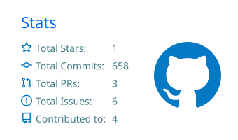
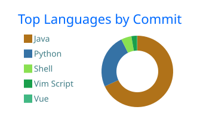

<div align="center">

## Hey, I'm Omar

IT student at UW Tacoma · Information Assurance & Cybersecurity

<a href="https://www.linkedin.com/in/submus/"></a>
<a href="https://www.instagram.com/rushian_c"></a>
<a href="mailto:zinho@duck.com"></a>
<a href="https://github.com/submus"></a>

</div>

---

### About

I'm into networking, infrastructure, and security. Right now that looks like working through Cisco's CCNA track, tinkering with my home lab, and living in the terminal more than I probably should.

Long term I'm heading toward DevOps and SRE, with security research on the side.

### Currently

```text
learning   CCNA: Introduction to Networks, Linux, data structures and algorithms
building   home lab setup, my Neovim config (moving it to Lua)
studying   IT @ UW Tacoma, class of 2028
```

### Tools I use


### Stats

<div align="center">





</div>

---

<div align="center">
<sub>Always learning. Thanks for stopping by.</sub>
</div>

